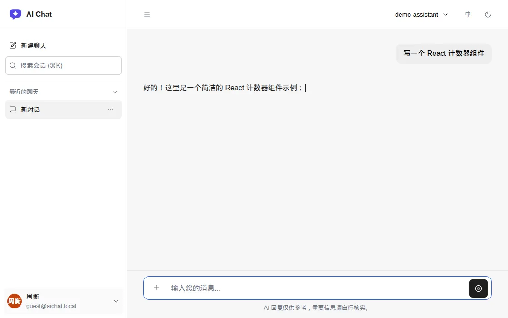
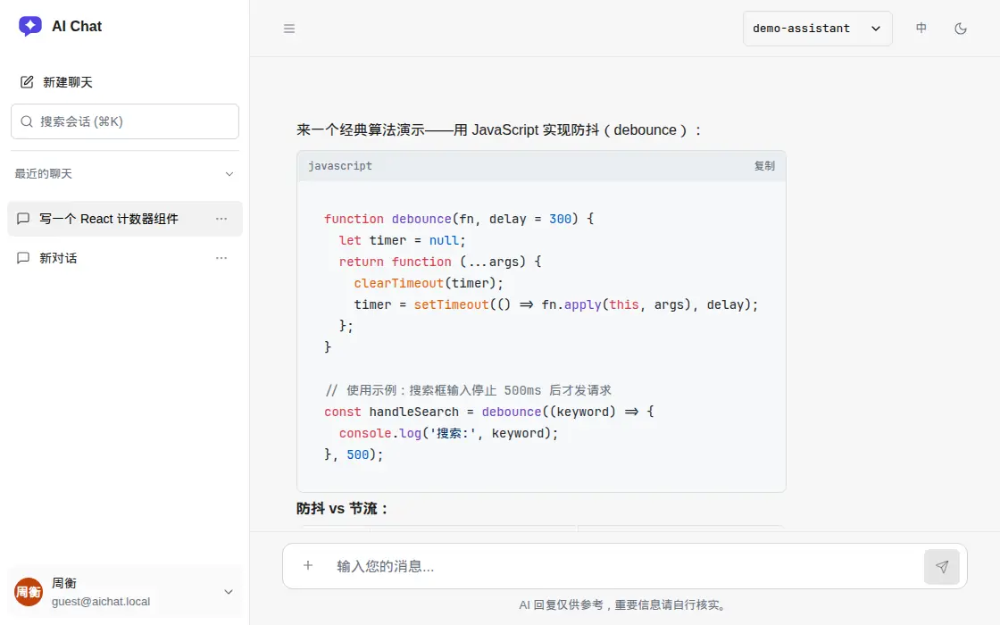
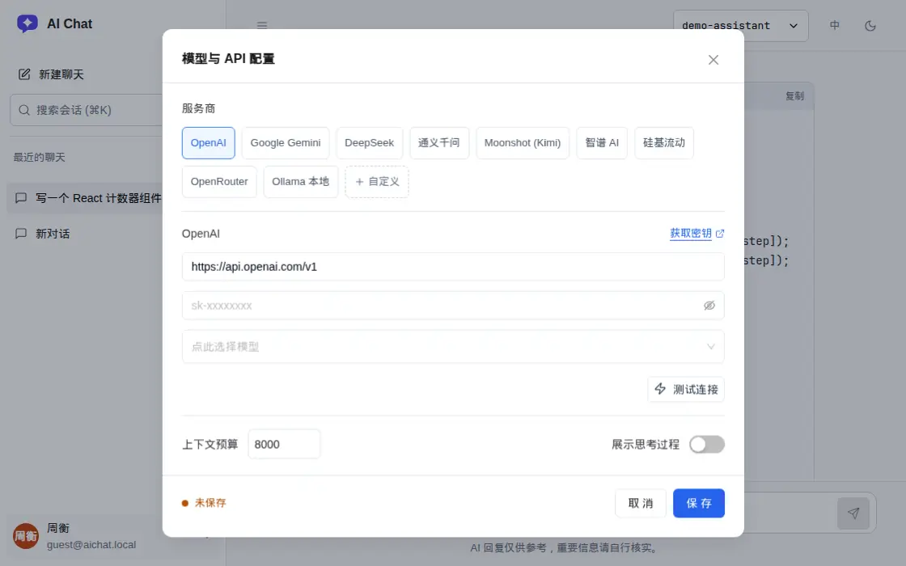
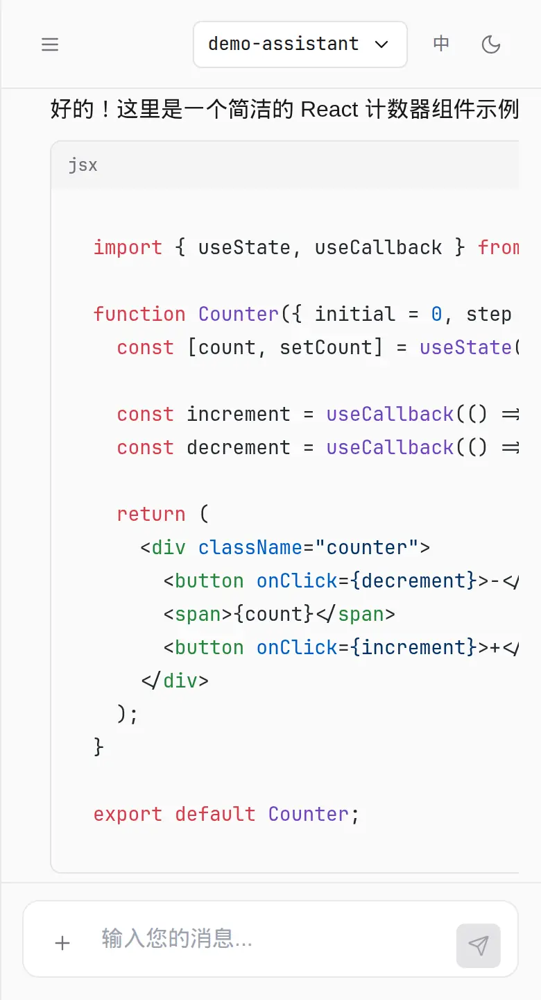

# AI Chat

浏览器里打开就能聊的聊天应用。默认用本地预设回复，方便直接试用；也可以接 OpenAI 兼容接口，或用自带的 Express 服务保存密钥并代理请求。

## 界面

免登录体验里的本地预设回复，不是真实模型，也没有填入 API Key。桌面三张是 1120×700，窄屏是 390×720。账号显示名是周衡。

<table>
  <tr>
    <td align="center" valign="top">
      
      <br>
      流式生成中可以停止
    </td>
    <td align="center" valign="top">
      
      <br>
      代码高亮，块顶可以复制
    </td>
  </tr>
  <tr>
    <td align="center" valign="top">
      
      <br>
      多家服务商，未填写密钥
    </td>
    <td align="center" valign="top">
      
      <br>
      窄屏下代码在块内横滑，输入框仍在底部
    </td>
  </tr>
</table>

## 功能

- 流式回复。可以停止、继续、重新生成，或改掉用户消息后重发。
- 多会话：搜索、重命名、置顶、导出 Markdown。记录在本机 IndexedDB。
- 中文 / 英文，浅色 / 深色。
- Markdown：代码高亮、表格、KaTeX，以及按需加载的 Mermaid。可以附图片和文本文件。
- 多家 OpenAI 兼容服务商。也可以把密钥交给 `server/`，由它代理上游。

## 技术栈

React 18 · Vite 5 · Tailwind CSS · Ant Design 5 · MobX · IndexedDB · Express · SQLite

## 值得看的实现

- 三条通路：本地预设、浏览器直连上游、经 Express 代理。代理默认只放行 https 公网地址，拒绝内网和云元数据地址。
- 浏览器里的 API Key 和聊天正文用 AES-256-GCM 加密后落盘。服务器托管时，密钥不回填到页面。
- 流式 SSE。生成中的长 Markdown 拆成稳定前缀和活动尾部，避免整篇反复解析。
- 前端 Vitest，服务端 `node --test`（登录、限流、代理）。CI 使用 Node.js 22，跑 lint、测试和构建。

模型接入的分层见 [docs/PROVIDER_ARCHITECTURE.md](./docs/PROVIDER_ARCHITECTURE.md)。

## 快速开始

需要 Node.js 22。下面两组命令已在本机 Node.js 22.23.4 上跑通：`npm ci` 装好依赖，`npm run dev` 在 `http://localhost:5173` 起前端。

```bash
npm ci
npm run dev
```

在手机或其他设备上访问时，请使用 HTTPS。非 localhost 的 HTTP 地址无法使用浏览器的会话加密功能。

登录页可以点「免登录体验」，或用预置账号 `demo@aichat.local` / `Demo@2026`（显示名陈予安）。这组口令写在源码里，只适合本地演示。

同时跑后端、环境变量和 Docker 见 [docs/setup.md](./docs/setup.md)。

## 目录

```text
src/components    聊天、侧栏、设置
src/apis          登录、流式请求、provider
src/store         IndexedDB 与模型配置
server/src        Express、SQLite、上游代理
```

## 许可证

[MIT](./LICENSE)
