# React Chat GPT

浏览器里就能聊起来的全栈 AI 聊天应用。界面名称是 **AI Chat**：支持中英文、浅色 / 深色主题、多会话，以及把 OpenAI 兼容接口的流式回复渲染成 Markdown、代码、公式和表格。默认是纯前端演示；接上 `server/` 之后，登录态和 API Key 留在服务端，由 Express 代理上游。

[](https://github.com/suijiafeng/react-chat-gpt/actions/workflows/ci.yml)
[](./LICENSE)

## 界面

桌面截图视口 1440×900，手机 375×812。对话里的助手正文来自本机 OpenAI 兼容假上游（`ALLOW_LOCAL_UPSTREAM=true` 仅用于这次本地截图），模型名为 `local-writer`，回复以「【本地模拟回复】」标明不是真实模型。侧栏账号 `xiaoman@example.com` 是为截图注册的示例邮箱。

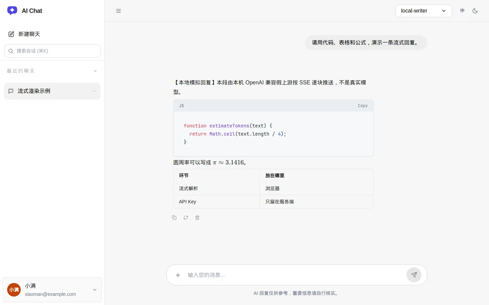

生成过程中可以停止。下图停在代码块写到一半的时候，侧栏标题还是首条消息落库前的「新对话」；生成结束后会用当前模型再起一个短标题（这里是「流式渲染示例」）。

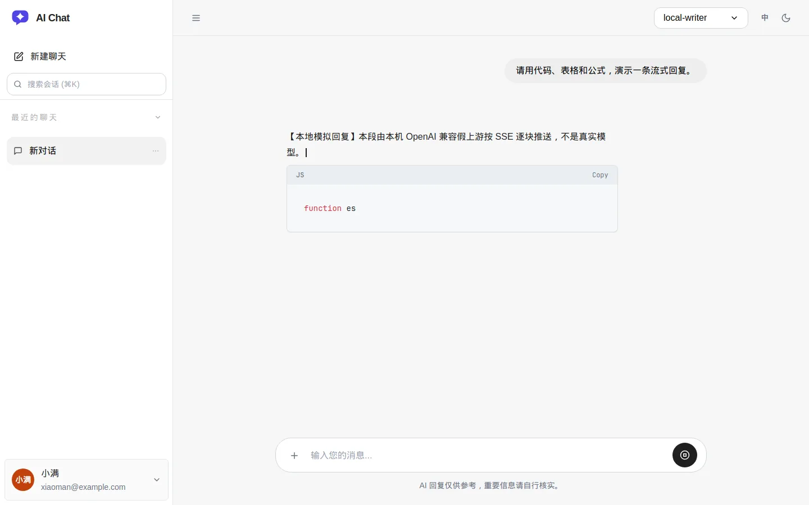

空会话把输入框放在欢迎语下面，并给出可填入输入框的提示词模板。

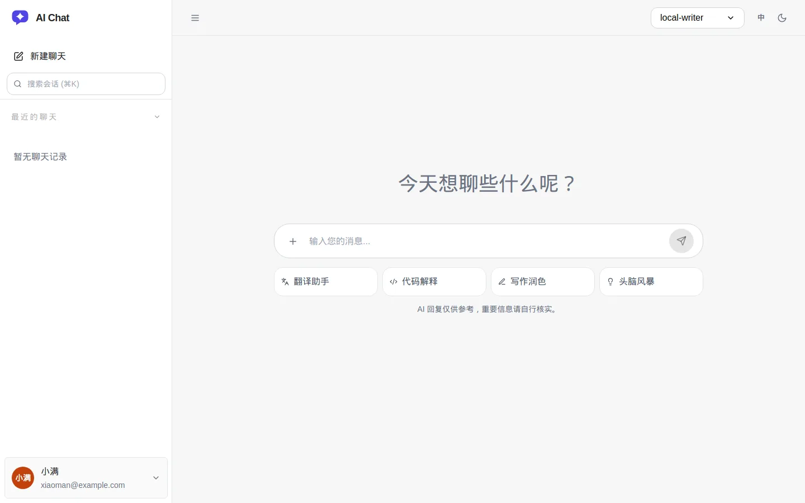

同一条对话切到英文界面。文案走 `src/locales/`，会话正文仍是刚才那条中文回复。

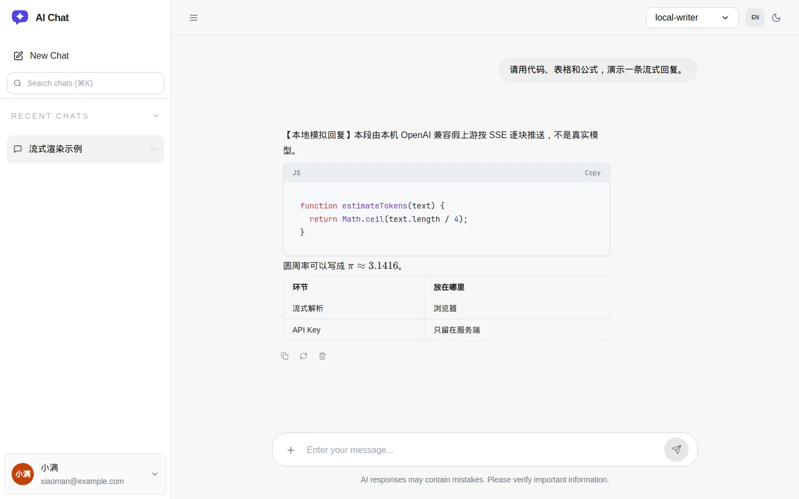

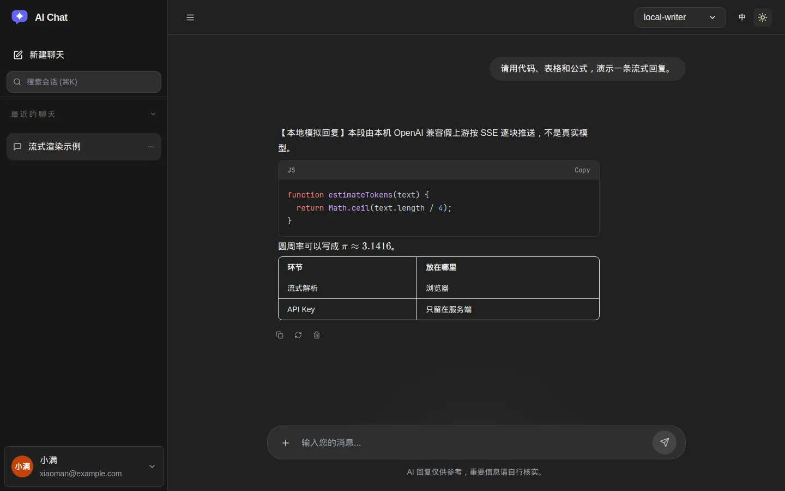

设置里可以同时保留多家服务商。下面选中的是「服务器托管」：地址和模型名会保存，密钥框只显示「已在服务器保存」，不把明文 Key 回填到页面。图中的 Base URL 是截图用的本机假上游。

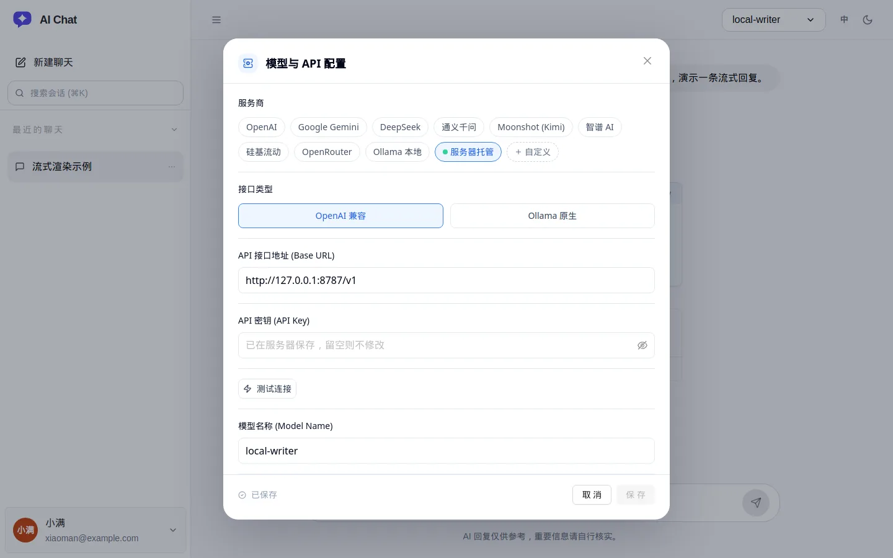

登录页可以切换中英文。纯前端构建还会在登录表单下提示默认演示账号；对接真实后端时这条提示不出现，避免把公开口令带到部署环境。

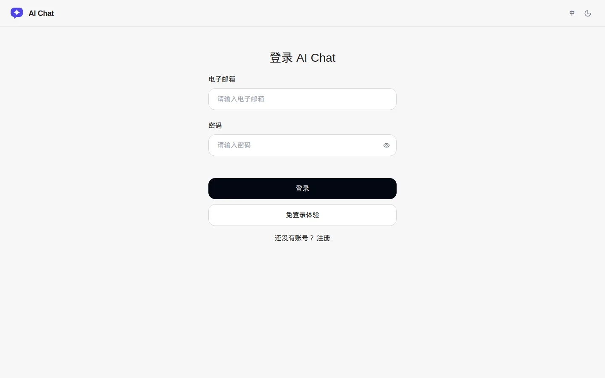

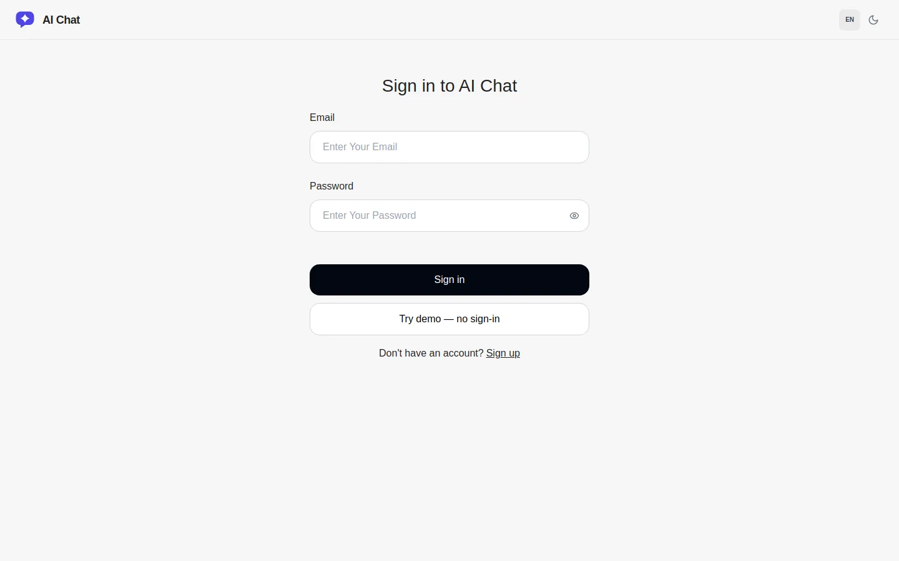

窄屏侧栏收成抽屉，对话区占满宽度。

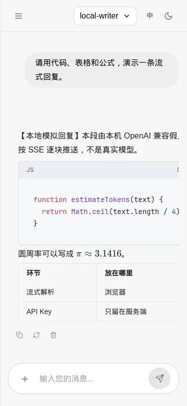

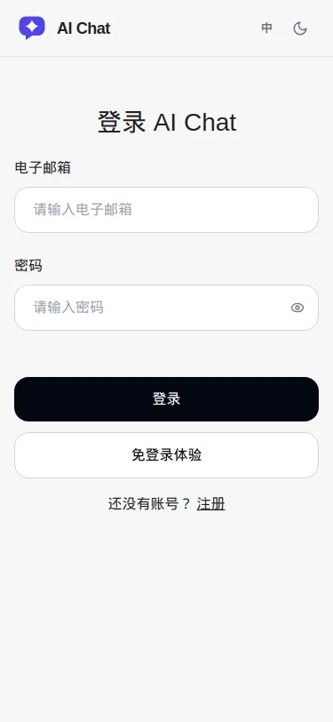

## 功能

### 对话

- 流式输出，可停止。切走会话或离开页面时，已生成的半截回复会写入本地库，并标成可「继续生成」。
- 消息可以复制、删除、重新生成，也可以编辑用户消息后从那里重发。
- 首条回复结束后，用当前模型起一个不超过 10 个字的标题；失败则截取用户原文前 20 个字（`src/apis/chat.js`）。
- 会话可搜索、重命名、置顶、导出 Markdown，也可清空当前账号的全部会话。
- 每个会话可以单独保存系统提示词。
- 空会话的提示词：演示回复时是四张中文卡片（使用教程、提示词技巧、代码示例、Markdown 演示），点下去直接发送；接上真实或托管模型后，换成可随语言切换的模板（翻译、解释代码、润色、头脑风暴），点下去只填入输入框。
- Markdown 使用 GFM 表格、KaTeX、代码高亮，以及按需加载的 Mermaid。流式过程中长文本拆成稳定前缀和活动尾部，避免整篇反复解析（`src/utils/streamingMarkdown.js`）。
- 图片最多 6 张，单文件 20MB。图片会压到最长边 2000 像素后以 data URL 进消息；PDF 用 pdfjs 抽文本，常见文本和代码文件直接读入，超长正文截到 6 万字。输入框本身也卡在 6 万字。
- 模型名看起来不像视觉模型时，附带图片会有一次软提醒，仍然允许发送。
- 上下文按粗略 token 预算从最新消息往前保留，系统提示词留在开头（默认 8000，可在设置里改）。
- 思考内容兼容 `reasoning_content`、`reasoning` 和 `<think>`。设置里的「展示思考过程」会按上游域名附带各自的开关参数（Anthropic、Gemini、通义、智谱，见 `server/src/routes/llm.js` 与 `src/apis/providers/thinkTags.js`）。
- 中文等输入法组字期间，Enter 用来上屏，不会把未确认的拼音发出去（`src/utils/ime.js`）。

### 账号与本地数据

- 路由是 HashRouter：`/#/login`、`/#/new`、`/#/c/:chatId`。未登录访问会话会被送回登录页，登录后回到原来的地址。
- 纯前端（默认）把账号放进 IndexedDB。密码用 16 字节盐和 PBKDF2-SHA-256（10 万次）派生，比较时走恒定时间；登录失败统一说「邮箱或密码不正确」。服务端账号则用 bcrypt。
- 预置演示账号 `demo@aichat.local` / `Demo@2026`（显示名 Demo User）。种子写在固定 id 上，旧库里的演示口令对不上时，用这组公开凭据登录会把种子覆盖成当前版本。
- 「免登录体验」是另一个身份 `guest@aichat.local`，没有密码。它和演示账号的会话、配置互不可见。退出免登录会清掉这次体验的会话、模型和昵称。
- 聊天记录只在浏览器里。即使走服务器托管，消息正文、标题、附件和系统提示词仍然进 IndexedDB，并用不可导出的 AES-256-GCM 主密钥加密（`src/utils/keyVault.js`、`src/store/db.js`）。服务端不保存对话内容。
- 模型配置按账号分键存在 localStorage。浏览器直连时，API Key 同样先加密再落盘，设置表单不回填明文。
- 个人设置可以改昵称、导出或清空当前账号的会话。后端模式下改昵称只更新本地 session，服务端没有改名接口。

### 模型接入

内置 9 家 OpenAI 兼容预设（`src/constants/providerPresets.js`）：OpenAI、Google Gemini、DeepSeek、通义千问、Moonshot (Kimi)、智谱 AI、硅基流动、OpenRouter、Ollama 本地。也可以再加自定义地址。每家单独保存地址、密钥、模型列表和启用项，聊天页顶部按当前配置切换。

实际走哪条通道由 `src/store/llmConfig.js` 的 `resolveProviderName()` 决定：

1. 设置里保存过「服务器托管」时，请求发到本应用的 `/api/v1/llm/chat/completions`，浏览器不接触上游 Key。
2. 否则，只要有一家填了地址并且选了模型，就由浏览器直接请求该地址。
3. 再否则，纯前端构建或免登录体验使用本地预设回复（`DemoProvider` 逐字输出）。
4. 后端构建里如果两者都没有，才落到 `VITE_DEFAULT_LLM_PROVIDER`。该值是 `demo` 或 `custom` 时照用，其他值会落到 Ollama 驱动。

服务器托管还提供「测试连接」和按模型探测：不带模型名时拉 `/models`，带模型名时发一条最多 8 个 token 的非流式对话。Ollama 可以选择原生 `/api/chat`，服务端把 NDJSON 转成前端已经在解析的 SSE。

上游地址在保存和每次转发时都会检查（`server/src/upstreamUrl.js`）：默认只允许 https 公网地址；`ALLOW_LOCAL_UPSTREAM=true` 才额外允许 `localhost`、`127.0.0.1`、`::1`。私有网段、链路本地地址和云元数据地址 `169.254.169.254` 一律拒绝，302 也不跟随。

## 技术栈

| 部分 | 选型 |
| --- | --- |
| 界面 | React 18、Vite 5、Tailwind CSS、Ant Design 5、Lucide |
| 状态与路由 | MobX（当前用户）、`useSyncExternalStore`（模型配置）、React Router 6 HashRouter |
| 文案 | i18next，默认中文，可切英文 |
| 本地库 | IndexedDB（`idb`）存用户、会话、消息；localStorage 存主题、语言和模型配置 |
| 请求 | 浏览器内 axios；流式对话用 `fetch` 读 SSE |
| 服务端 | Node.js、Express 4、better-sqlite3、bcryptjs、express-session |
| 测试 | 前端 Vitest，服务端 `node --test` |
| 部署 | 前端多阶段镜像（Node 20 构建 + nginx），后端 `node:20-slim`；`docker-compose.yml` 把两者接在同一个入口上 |

CI（`.github/workflows/ci.yml`）在 push 和 pull request 上使用 Node 22，依次执行 `npm ci`、服务端 `npm ci`、lint、前端测试、服务端测试和 `npm run build`。

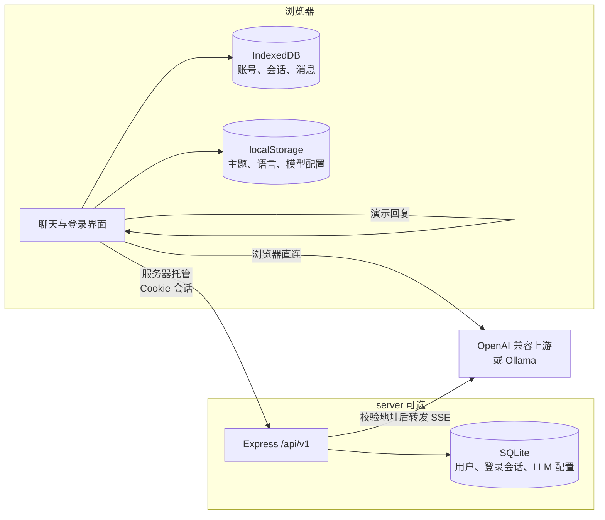

## 快速开始

需要 Node.js 20 或 22（本仓库 CI 使用 22）。Docker 只在容器部署时需要。

### 纯前端演示

```bash
npm ci
npm run dev
```

开发服务器是 Vite，默认地址 `http://localhost:5173`（`vite.config.js` 没有改端口）。不创建 `.env.local` 时 `VITE_USE_LOCAL_DATA` 视为 `true`。

登录页可以点「免登录体验」，或使用预置账号：

| 身份 | 邮箱 | 密码 | 数据 |
| --- | --- | --- | --- |
| 预置演示账号 | `demo@aichat.local` | `Demo@2026` | 与免登录体验分开 |
| 免登录体验 | `guest@aichat.local` | 无 | 退出即清空 |

这组口令写在源码和本地构建的登录页上，只适合演示。

### 前后端一起跑

```bash
npm ci
npm ci --prefix server
cp .env.example .env.local
cp server/.env.example server/.env
```

`.env.local` 里改为：

```bash
VITE_USE_LOCAL_DATA=false
VITE_WEBUI_BASE_URL=http://localhost:3000
```

`server/.env` 里至少换掉 `SESSION_SECRET` 和 `ENCRYPTION_KEY`（`openssl rand -hex 32`）。要让服务端访问本机的 Ollama、LM Studio、vLLM 或兼容假上游时，再把 `ALLOW_LOCAL_UPSTREAM` 设为严格的 `true`。未设置或其他值都不会放行本机地址。

```bash
npm run dev:all
```

前端 `http://localhost:5173`，后端 `http://localhost:3000`。健康检查是 `GET /api/v1/health`。注册一个自己的账号后，在设置里选「服务器托管」，填上游地址和模型名。

### 前端环境变量

复制 `.env.example` 为 `.env.local`。Vite 只把 `VITE_` 前缀暴露给浏览器。

| 变量 | 默认 | 作用 |
| --- | --- | --- |
| `VITE_USE_LOCAL_DATA` | 未设置时为 `true` | `true` 使用 IndexedDB 和本地回复；字符串 `true` 以外的值会去请求后端 |
| `VITE_WEBUI_BASE_URL` | 未设置时，页面主机名是 `localhost` 或端口是 `3000` 则用 `http://<主机名>:3000`，否则为空 | 后端根地址，接口挂在 `${BASE}/api/v1`。同源部署（compose）留空 |
| `VITE_APP_NAME` | `AI Chat` | 页面标题和 Logo 文案 |
| `VITE_DEFAULT_LLM_PROVIDER` | `demo` | 没有可用服务商、也不是演示数据模式时的提供方 |
| `VITE_DEFAULT_LLM_MODEL` | `gpt-4o-mini` | 还没有选中模型时的显示名和请求名 |

GitHub Pages 工作流还会按仓库名写入 `VITE_BASE`（用户站是 `/`，项目站是 `/<仓库名>/`）。那是构建参数，不是 `.env.example` 里的项。

### 后端环境变量

样例在 `server/.env.example`。生产环境没有 `SESSION_SECRET` 会直接退出。`ENCRYPTION_KEY` 在第一次加密 Key 时检查：必须是 64 位十六进制，且不能是样例里的全 0。

| 变量 | 默认 | 作用 |
| --- | --- | --- |
| `PORT` | `3000` | 监听端口。测试里用 `0` 申请随机端口 |
| `CORS_ORIGIN` | `http://localhost:5173` | 允许带 Cookie 的来源，多个用逗号分隔 |
| `SESSION_SECRET` | 开发环境临时密钥并打印警告；生产环境必填 | 签名会话 Cookie |
| `ENCRYPTION_KEY` | 无合法默认值 | 加密落库的上游 API Key，AES-256-GCM |
| `COOKIE_SECURE` | 关闭 | 设为 `true` 时 Cookie 带 Secure |
| `DB_PATH` | `server/data/app.sqlite` | SQLite 文件位置。集成测试会指到临时文件 |
| `LLM_RATE_MAX` | `30` | 每个已登录用户在窗口内最多发起的对话次数 |
| `LLM_RATE_WINDOW_MS` | `60000` | 上面的窗口长度 |
| `AUTH_SIGNIN_MAX` | `10` | 每个来源 IP 在窗口内最多登录次数 |
| `AUTH_SIGNIN_WINDOW_MS` | `900000`（15 分钟） | 登录限流窗口 |
| `AUTH_SIGNUP_MAX` | `5` | 每个来源 IP 在窗口内最多注册次数 |
| `AUTH_SIGNUP_WINDOW_MS` | `3600000`（1 小时） | 注册限流窗口 |
| `TRUST_PROXY` | 关闭 | `1` 或 `true` 时只信任一层反向代理，登录限流按 `X-Forwarded-For` 里的客户端 IP 计数 |
| `ALLOW_LOCAL_UPSTREAM` | 关闭 | 只有精确等于 `true` 才允许上游指向本机回环地址 |

限流计数在进程内存里。开多个实例时，各进程各算各的。

### 脚本

| 命令 | 作用 |
| --- | --- |
| `npm run dev` | 只起前端 |
| `npm run dev:server` | 只起后端（`node --watch`） |
| `npm run dev:all` | 前端和后端一起起 |
| `npm test` | 前端 Vitest |
| `npm run test:server` | 服务端 `node --test`，含登录、限流、加密和代理集成测试 |
| `npm run test:all` | 上面两项 |
| `npm run lint` | ESLint 9 flat config，前后端一起查 |
| `npm run build` | 产出 `dist/` |
| `npm run preview` | 预览构建结果 |

### 部署

纯前端：

```bash
npm run build
docker build -t react-chat-gpt .
docker run -d -p 8080:80 react-chat-gpt
```

镜像用 nginx 提供 `dist/`。路由是 HashRouter，静态托管不需要服务端回退到 `index.html` 也能打开深层链接。构建默认仍是本地演示数据。

前后端一体：

```bash
cp .env.docker.example .env
# 改 SESSION_SECRET 和 ENCRYPTION_KEY
docker compose up -d --build
```

浏览器访问 `http://localhost:8080`（`WEB_PORT` 可改）。nginx 把 `/api/` 反代到 server 容器，并关闭代理缓冲，SSE 可以边生成边到浏览器。数据卷 `server-data` 挂住 SQLite。compose 里 `TRUST_PROXY` 默认是 `1`，`ALLOW_LOCAL_UPSTREAM` 默认是 `false`，两者都可以用 `.env` 覆盖。容器里的 localhost 是容器自己，一般保持关闭。

`.github/workflows/pages.yml` 只在 `main` 上的 CI 成功之后，或手动触发时，构建并部署静态站点。没有配置 Actions 变量 `VITE_WEBUI_BASE_URL` 时，这个站点是纯前端演示。本仓库没有另附一个已核实的在线地址。

## 目录

```text
src/
├── apis/                 # axios、登录、聊天、模型列表
│   └── providers/        # demo / OpenAI 兼容 / Ollama / 后端代理
├── appRoutes/            # HashRouter 与登录拦截
├── components/           # 聊天、侧栏、设置、Markdown
├── constants/            # 演示账号、服务商预设、提示词
├── contexts/             # 浅色 / 深色主题
├── hooks/                # useChat、语言、登录态
├── locales/              # zh 与 en
├── pages/                # 登录、404
├── store/                # IndexedDB、按账号隔离的模型配置
└── utils/                # 加密、附件、上下文裁剪、IME、导出
server/
├── src/routes/           # /auths 与 /llm
├── src/middleware/       # 登录校验、内存限流
├── src/upstreamUrl.js    # 上游地址校验与 safeFetch
├── src/crypto.js         # API Key 的 AES-256-GCM
├── src/db.js             # 用户与 llm_configs
└── src/sessionStore.js   # 会话落在同一份 SQLite
.github/workflows/        # ci.yml、pages.yml
```

## 实现要点

**登录。** 注册密码至少 6 位，bcrypt cost 10。邮箱会转成小写。用户不存在时仍用固定哈希做一次 bcrypt 比较，再和密码错误返回同一句「邮箱或密码不正确」。登录成功先 `regenerate` 会话 id，再写入 `userId`。Cookie 为 HttpOnly、SameSite=Lax，有效期 7 天，存在 SQLite 的 `sessions` 表里，过期记录每小时清理一次。退出时销毁服务端会话。前端在后端模式下还会请求 `GET /api/v1/auths/me`，401 则清掉本地登录态。

**限流。** 登录和注册按来源 IP，对话补全按用户 id，都是固定窗口，响应里带 `X-RateLimit-*`，超额返回 429 和 `Retry-After`。服务直接暴露在公网上时不要开 `TRUST_PROXY`，否则客户端可以伪造 `X-Forwarded-For`，把登录限流拆进不同的桶。

**上游与密钥。** 服务器托管把 Key 加密成 `iv:authTag:ciphertext` 再写入 `llm_configs`。读取配置只告诉前端「有没有 Key」。测试连接的密钥放在 POST body 里。代理使用 `safeFetch`：解析 DNS 后只要有一条记录落在私有或保留地址就拒绝，并且 `redirect: 'manual'`。流式响应带 `X-Accel-Buffering: no`。浏览器断开时用响应对象的 `close` 中止上游请求；上游中途断开则补一条 SSE 错误块，前端保留已经收到的文字并标成错误。

**本地加密的边界。** 浏览器里的主密钥 `extractable: false`，单独拷走 localStorage 读不出 API Key 和聊天正文。同源脚本只要还在页面里运行，仍然可以调用解密函数。需要把 Key 留在浏览器外面时，用服务器托管。

**测试。** 前端覆盖 SSE 粘包、思考标签、标题兜底、附件、密钥库、会话排序、IME 和系统提示词拼接。服务端覆盖加解密、限流、上游地址，以及真实监听随机端口的注册、登录、配置不回显 Key、模型列表转发和上游中断补错误块。集成测试自己拉起一个假的兼容上游，因此显式打开 `ALLOW_LOCAL_UPSTREAM`。

## 已知限制

这些都来自当前代码，不是排期。

- 对话历史不同步到服务器。换浏览器、清站点数据，或在另一台机器登录同一个账号，都看不到原来的会话。
- 登录限流、对话限流和 express-session 都在单机内存或本地 SQLite 上。多实例不会共享计数，会话也不会跟着走。
- `upstreamUrl.js` 写明：先解析 DNS 再连接，存在 DNS rebinding 的时间窗口。当前实现没有在连接层按已校验的 IP 直连。
- 代码块上的复制按钮写死为英文 `Copy` / `Copied!`（`src/components/MarkdownContent.jsx`）。演示模式的四张提示词卡片标题也是中文常量。新建会话在标题生成完成前固定叫「新对话」。
- 后端没有修改昵称的接口。
- 本机上游默认关闭。公网、多用户或开放注册的部署应保持 `ALLOW_LOCAL_UPSTREAM` 不为 `true`。

## 许可证

[MIT](./LICENSE)。Copyright (c) 2026 suijiafeng。

---

> **声明**：本仓库为个人项目，仅供学习交流。
